# Hemo-Hero Database Structure

Generated from the live Supabase database on 2026-10-14 by `npm run schema:doc` (server folder). Don't edit this file by hand; run the command again after a migration.

The tables live in the `public` schema of Supabase (PostgreSQL). Sign-in accounts are Supabase Auth users, and `users.id` is the same id. The server reads and writes with the service role, so the apps never touch the tables directly.

Schema changes are in [migrations](migrations/), run in date order in the Supabase SQL editor.

## Summary

18 tables, 41 foreign keys.

| Table | Columns | Foreign keys | Purpose |
| --- | --- | --- | --- |
| [users](#users) | 22 | 0 | Every account: donors, requesters and admins. The id is the Supabase Auth user id. role is user, admin or super_admin. |
| [donor_applications](#donor_applications) | 22 | 2 | A user's application to become a donor: eligibility answers, blood type, availability and the admin's review. |
| [blood_requests](#blood_requests) | 25 | 2 | Blood requests posted by requesters: blood type, bags needed, urgency, schedule, meet-up location and status. |
| [blood_request_responses](#blood_request_responses) | 7 | 2 | A donor's offer to help with a request (pending, accepted, rejected, no-show and so on). |
| [blood_request_invitations](#blood_request_invitations) | 9 | 3 | A requester's invitation to a specific donor to help with a request. |
| [blood_request_coordination_messages](#blood_request_coordination_messages) | 6 | 3 | Chat messages between the requester and a donor about a request. |
| [blood_request_coordination_schedules](#blood_request_coordination_schedules) | 12 | 5 | The meet-up time for a requester and donor: suggested by one side (status proposed) until the other agrees (agreed). |
| [blood_request_trips](#blood_request_trips) | 22 | 3 | The donor's live trip to the meet-up location (shared location and arrival). |
| [blood_donations](#blood_donations) | 23 | 5 | Donations recorded when a request is completed. Flagged ones wait for admin review. |
| [donation_feedback](#donation_feedback) | 10 | 4 | Ratings and comments both sides leave after a donation. |
| [user_reports](#user_reports) | 17 | 5 | Problems reported by users (no-shows, false requests and other issues) for admin review. |
| [notifications](#notifications) | 10 | 2 | In-app notifications for users and admins. |
| [push_tokens](#push_tokens) | 6 | 1 | Expo push notification tokens, one per signed-in device. |
| [activity_logs](#activity_logs) | 17 | 1 | The log trail: every user and admin action. Only admins and the super admin can view it. |
| [facility_locations](#facility_locations) | 12 | 0 | Verified hospitals, blood banks and Red Cross chapters shown on the map. |
| [notification_preferences](#notification_preferences) | 7 | 1 | Which kinds of updates alert a user's phone. No row means everything is on. |
| [login_lockouts](#login_lockouts) | 7 | 0 | Failed sign-in counts and lockouts per email, so a lockout survives a server restart. |
| [data_backups](#data_backups) | 10 | 2 | The list of database backups. The backup files are in the private backups storage bucket. |

## Relationships

Primary and foreign key columns only. Every table is listed in full under Tables.

```mermaid
erDiagram
  users {
    uuid id PK
  }
  donor_applications {
    uuid id PK
    uuid user_id FK
    uuid reviewed_by FK
  }
  blood_requests {
    uuid id PK
    uuid requester_id FK
    uuid removed_by FK
  }
  blood_request_responses {
    uuid id PK
    uuid request_id FK
    uuid donor_id FK
  }
  blood_request_invitations {
    uuid id PK
    uuid request_id FK
    uuid requester_id FK
    uuid donor_id FK
  }
  blood_request_coordination_messages {
    uuid id PK
    uuid request_id FK
    uuid response_id FK
    uuid sender_id FK
  }
  blood_request_coordination_schedules {
    uuid id PK
    uuid request_id FK
    uuid response_id FK
    uuid created_by FK
    uuid updated_by FK
    uuid proposed_by FK
  }
  blood_request_trips {
    uuid id PK
    uuid request_id FK
    uuid response_id FK
    uuid donor_id FK
  }
  blood_donations {
    uuid id PK
    uuid request_id FK
    uuid response_id FK
    uuid donor_id FK
    uuid requester_id FK
    uuid verified_by FK
  }
  donation_feedback {
    uuid id PK
    uuid donation_id FK
    uuid request_id FK
    uuid from_user_id FK
    uuid to_user_id FK
  }
  user_reports {
    uuid id PK
    uuid reporter_id FK
    uuid reported_user_id FK
    uuid request_id FK
    uuid response_id FK
    uuid reviewed_by FK
  }
  notifications {
    uuid id PK
    uuid user_id FK
    uuid related_request_id FK
  }
  push_tokens {
    uuid id PK
    uuid user_id FK
  }
  activity_logs {
    uuid id PK
    uuid user_id FK
  }
  facility_locations {
    uuid id PK
  }
  notification_preferences {
    uuid user_id PK, FK
  }
  login_lockouts {
    text email PK
  }
  data_backups {
    uuid id PK
    uuid created_by FK
    uuid restored_by FK
  }
  users ||--o{ donor_applications : "user_id"
  users o|--o{ donor_applications : "reviewed_by"
  users ||--o{ blood_requests : "requester_id"
  users o|--o{ blood_requests : "removed_by"
  blood_requests ||--o{ blood_request_responses : "request_id"
  users ||--o{ blood_request_responses : "donor_id"
  blood_requests ||--o{ blood_request_invitations : "request_id"
  users ||--o{ blood_request_invitations : "requester_id"
  users ||--o{ blood_request_invitations : "donor_id"
  blood_requests ||--o{ blood_request_coordination_messages : "request_id"
  blood_request_responses ||--o{ blood_request_coordination_messages : "response_id"
  users ||--o{ blood_request_coordination_messages : "sender_id"
  blood_requests ||--o{ blood_request_coordination_schedules : "request_id"
  blood_request_responses ||--o{ blood_request_coordination_schedules : "response_id"
  users o|--o{ blood_request_coordination_schedules : "created_by"
  users o|--o{ blood_request_coordination_schedules : "updated_by"
  users o|--o{ blood_request_coordination_schedules : "proposed_by"
  blood_requests ||--o{ blood_request_trips : "request_id"
  blood_request_responses ||--o{ blood_request_trips : "response_id"
  users ||--o{ blood_request_trips : "donor_id"
  blood_requests o|--o{ blood_donations : "request_id"
  blood_request_responses o|--o{ blood_donations : "response_id"
  users o|--o{ blood_donations : "donor_id"
  users o|--o{ blood_donations : "requester_id"
  users o|--o{ blood_donations : "verified_by"
  blood_donations ||--o{ donation_feedback : "donation_id"
  blood_requests o|--o{ donation_feedback : "request_id"
  users o|--o{ donation_feedback : "from_user_id"
  users o|--o{ donation_feedback : "to_user_id"
  users o|--o{ user_reports : "reporter_id"
  users o|--o{ user_reports : "reported_user_id"
  blood_requests o|--o{ user_reports : "request_id"
  blood_request_responses o|--o{ user_reports : "response_id"
  users o|--o{ user_reports : "reviewed_by"
  users ||--o{ notifications : "user_id"
  blood_requests o|--o{ notifications : "related_request_id"
  users ||--o{ push_tokens : "user_id"
  users o|--o{ activity_logs : "user_id"
  users ||--o{ notification_preferences : "user_id"
  users o|--o{ data_backups : "created_by"
  users o|--o{ data_backups : "restored_by"
```

| From | To |
| --- | --- |
| donor_applications.user_id | users.id |
| donor_applications.reviewed_by | users.id |
| blood_requests.requester_id | users.id |
| blood_requests.removed_by | users.id |
| blood_request_responses.request_id | blood_requests.id |
| blood_request_responses.donor_id | users.id |
| blood_request_invitations.request_id | blood_requests.id |
| blood_request_invitations.requester_id | users.id |
| blood_request_invitations.donor_id | users.id |
| blood_request_coordination_messages.request_id | blood_requests.id |
| blood_request_coordination_messages.response_id | blood_request_responses.id |
| blood_request_coordination_messages.sender_id | users.id |
| blood_request_coordination_schedules.request_id | blood_requests.id |
| blood_request_coordination_schedules.response_id | blood_request_responses.id |
| blood_request_coordination_schedules.created_by | users.id |
| blood_request_coordination_schedules.updated_by | users.id |
| blood_request_coordination_schedules.proposed_by | users.id |
| blood_request_trips.request_id | blood_requests.id |
| blood_request_trips.response_id | blood_request_responses.id |
| blood_request_trips.donor_id | users.id |
| blood_donations.request_id | blood_requests.id |
| blood_donations.response_id | blood_request_responses.id |
| blood_donations.donor_id | users.id |
| blood_donations.requester_id | users.id |
| blood_donations.verified_by | users.id |
| donation_feedback.donation_id | blood_donations.id |
| donation_feedback.request_id | blood_requests.id |
| donation_feedback.from_user_id | users.id |
| donation_feedback.to_user_id | users.id |
| user_reports.reporter_id | users.id |
| user_reports.reported_user_id | users.id |
| user_reports.request_id | blood_requests.id |
| user_reports.response_id | blood_request_responses.id |
| user_reports.reviewed_by | users.id |
| notifications.user_id | users.id |
| notifications.related_request_id | blood_requests.id |
| push_tokens.user_id | users.id |
| activity_logs.user_id | users.id |
| notification_preferences.user_id | users.id |
| data_backups.created_by | users.id |
| data_backups.restored_by | users.id |

## Tables

Null "no" means the column is required (NOT NULL).

### users

Every account: donors, requesters and admins. The id is the Supabase Auth user id. role is user, admin or super_admin.

| Column | Type | Null | Default | Key |
| --- | --- | --- | --- | --- |
| id | uuid | no |  | PK |
| first_name | text | no |  |  |
| last_name | text | no |  |  |
| email | text | no |  |  |
| phone | text | yes |  |  |
| role | text | no | `user` |  |
| created_at | timestamptz | no | `now()` |  |
| updated_at | timestamptz | no | `now()` |  |
| middle_name | text | yes |  |  |
| suffix | text | yes |  |  |
| date_of_birth | date | yes |  |  |
| gender | text | yes |  |  |
| barangay | text | yes |  |  |
| city | text | yes |  |  |
| province | text | yes |  |  |
| blood_type | text | yes |  |  |
| profile_photo_url | text | yes |  |  |
| onboarding_complete | boolean | yes | `false` |  |
| latitude | double | yes |  |  |
| longitude | double | yes |  |  |
| is_active | boolean | no | `true` |  |
| deactivated_at | timestamptz | yes |  |  |

### donor_applications

A user's application to become a donor: eligibility answers, blood type, availability and the admin's review.

| Column | Type | Null | Default | Key |
| --- | --- | --- | --- | --- |
| id | uuid | no | `gen_random_uuid()` | PK |
| user_id | uuid | no |  | FK → users.id |
| blood_type | text | no |  |  |
| has_donated_before | boolean | no | `false` |  |
| last_donation_date | date | yes |  |  |
| last_donation_facility | text | yes |  |  |
| current_latitude | double | yes |  |  |
| current_longitude | double | yes |  |  |
| travel_radius_km | integer | no | `20` |  |
| availability_status | text | no | `available` |  |
| allow_urgent_requests | boolean | no | `true` |  |
| verification_id_path | text | no |  |  |
| consent_confirmed | boolean | no | `false` |  |
| status | text | no | `pending` |  |
| admin_note | text | yes |  |  |
| reviewed_by | uuid | yes |  | FK → users.id |
| reviewed_at | timestamptz | yes |  |  |
| submitted_at | timestamptz | no | `now()` |  |
| created_at | timestamptz | no | `now()` |  |
| updated_at | timestamptz | no | `now()` |  |
| last_donation_month | smallint | yes |  |  |
| last_donation_year | smallint | yes |  |  |

### blood_requests

Blood requests posted by requesters: blood type, bags needed, urgency, schedule, meet-up location and status.

| Column | Type | Null | Default | Key |
| --- | --- | --- | --- | --- |
| id | uuid | no | `gen_random_uuid()` | PK |
| requester_id | uuid | no |  | FK → users.id |
| blood_type | text | no |  |  |
| units_needed | integer | no | `1` |  |
| urgency | text | no | `normal` |  |
| status | text | no | `active` |  |
| created_at | timestamptz | no | `now()` |  |
| updated_at | timestamptz | no | `now()` |  |
| facility_source | text | yes |  |  |
| facility_id | text | yes |  |  |
| facility_name | text | yes |  |  |
| facility_type | text | yes |  |  |
| facility_address | text | yes |  |  |
| facility_latitude | double | yes |  |  |
| facility_longitude | double | yes |  |  |
| needed_date | date | yes |  |  |
| needed_time | time without time zone | yes |  |  |
| message | text | yes |  |  |
| fulfilled_at | timestamptz | yes |  |  |
| cancelled_at | timestamptz | yes |  |  |
| flagged_at | timestamptz | yes |  |  |
| removed_at | timestamptz | yes |  |  |
| removed_by | uuid | yes |  | FK → users.id |
| removal_reason | text | yes |  |  |
| expired_at | timestamptz | yes |  |  |

### blood_request_responses

A donor's offer to help with a request (pending, accepted, rejected, no-show and so on).

| Column | Type | Null | Default | Key |
| --- | --- | --- | --- | --- |
| id | uuid | no | `gen_random_uuid()` | PK |
| request_id | uuid | no |  | FK → blood_requests.id |
| donor_id | uuid | no |  | FK → users.id |
| status | text | no | `pending` |  |
| message | text | yes |  |  |
| created_at | timestamptz | no | `now()` |  |
| updated_at | timestamptz | no | `now()` |  |

### blood_request_invitations

A requester's invitation to a specific donor to help with a request.

| Column | Type | Null | Default | Key |
| --- | --- | --- | --- | --- |
| id | uuid | no | `gen_random_uuid()` | PK |
| request_id | uuid | no |  | FK → blood_requests.id |
| requester_id | uuid | no |  | FK → users.id |
| donor_id | uuid | no |  | FK → users.id |
| status | text | no | `pending` |  |
| message | text | yes |  |  |
| responded_at | timestamptz | yes |  |  |
| created_at | timestamptz | no | `now()` |  |
| updated_at | timestamptz | no | `now()` |  |

### blood_request_coordination_messages

Chat messages between the requester and a donor about a request.

| Column | Type | Null | Default | Key |
| --- | --- | --- | --- | --- |
| id | uuid | no | `gen_random_uuid()` | PK |
| request_id | uuid | no |  | FK → blood_requests.id |
| response_id | uuid | no |  | FK → blood_request_responses.id |
| sender_id | uuid | no |  | FK → users.id |
| message | text | no |  |  |
| created_at | timestamptz | no | `now()` |  |

### blood_request_coordination_schedules

The meet-up time for a requester and donor: suggested by one side (status proposed) until the other agrees (agreed).

| Column | Type | Null | Default | Key |
| --- | --- | --- | --- | --- |
| id | uuid | no | `gen_random_uuid()` | PK |
| request_id | uuid | no |  | FK → blood_requests.id |
| response_id | uuid | no |  | FK → blood_request_responses.id |
| scheduled_at | timestamptz | no |  |  |
| note | text | yes |  |  |
| created_by | uuid | yes |  | FK → users.id |
| updated_by | uuid | yes |  | FK → users.id |
| created_at | timestamptz | no | `now()` |  |
| updated_at | timestamptz | no | `now()` |  |
| status | text | yes |  |  |
| proposed_by | uuid | yes |  | FK → users.id |
| agreed_at | timestamptz | yes |  |  |

### blood_request_trips

The donor's live trip to the meet-up location (shared location and arrival).

| Column | Type | Null | Default | Key |
| --- | --- | --- | --- | --- |
| id | uuid | no | `gen_random_uuid()` | PK |
| request_id | uuid | no |  | FK → blood_requests.id |
| response_id | uuid | no |  | FK → blood_request_responses.id |
| donor_id | uuid | no |  | FK → users.id |
| status | text | no | `on_the_way` |  |
| latitude | double | yes |  |  |
| longitude | double | yes |  |  |
| accuracy_m | real | yes |  |  |
| heading | real | yes |  |  |
| distance_m | integer | yes |  |  |
| eta_seconds | integer | yes |  |  |
| start_distance_m | integer | yes |  |  |
| route_geometry | jsonb | yes |  |  |
| route_updated_at | timestamptz | yes |  |  |
| started_at | timestamptz | no | `now()` |  |
| location_updated_at | timestamptz | yes |  |  |
| near_notified_at | timestamptz | yes |  |  |
| arrived_at | timestamptz | yes |  |  |
| ended_at | timestamptz | yes |  |  |
| created_at | timestamptz | no | `now()` |  |
| updated_at | timestamptz | no | `now()` |  |
| arrival_disputed_at | timestamptz | yes |  |  |

### blood_donations

Donations recorded when a request is completed. Flagged ones wait for admin review.

| Column | Type | Null | Default | Key |
| --- | --- | --- | --- | --- |
| id | uuid | no | `gen_random_uuid()` | PK |
| request_id | uuid | yes |  | FK → blood_requests.id |
| response_id | uuid | yes |  | FK → blood_request_responses.id |
| donor_id | uuid | yes |  | FK → users.id |
| requester_id | uuid | yes |  | FK → users.id |
| donor_name | text | yes |  |  |
| requester_name | text | yes |  |  |
| blood_type | text | no |  |  |
| facility_name | text | yes |  |  |
| units_donated | smallint | no | `1` |  |
| donated_at | timestamptz | no |  |  |
| requester_note | text | yes |  |  |
| status | text | no | `completed` |  |
| admin_note | text | yes |  |  |
| verified_by | uuid | yes |  | FK → users.id |
| verified_at | timestamptz | yes |  |  |
| created_at | timestamptz | no | `now()` |  |
| updated_at | timestamptz | no | `now()` |  |
| review_reasons | text[] | no |  |  |
| dispute_note | text | yes |  |  |
| disputed_at | timestamptz | yes |  |  |
| donor_history_applied | boolean | no | `false` |  |
| previous_donor_history | jsonb | yes |  |  |

### donation_feedback

Ratings and comments both sides leave after a donation.

| Column | Type | Null | Default | Key |
| --- | --- | --- | --- | --- |
| id | uuid | no | `gen_random_uuid()` | PK |
| donation_id | uuid | no |  | FK → blood_donations.id |
| request_id | uuid | yes |  | FK → blood_requests.id |
| from_user_id | uuid | yes |  | FK → users.id |
| to_user_id | uuid | yes |  | FK → users.id |
| from_role | text | no |  |  |
| rating | smallint | no |  |  |
| comment | text | yes |  |  |
| created_at | timestamptz | no | `now()` |  |
| updated_at | timestamptz | no | `now()` |  |

### user_reports

Problems reported by users (no-shows, false requests and other issues) for admin review.

| Column | Type | Null | Default | Key |
| --- | --- | --- | --- | --- |
| id | uuid | no | `gen_random_uuid()` | PK |
| kind | text | no |  |  |
| reporter_id | uuid | yes |  | FK → users.id |
| reported_user_id | uuid | yes |  | FK → users.id |
| reporter_email | text | yes |  |  |
| reported_user_email | text | yes |  |  |
| request_id | uuid | yes |  | FK → blood_requests.id |
| response_id | uuid | yes |  | FK → blood_request_responses.id |
| reason | text | yes |  |  |
| details | text | yes |  |  |
| status | text | no | `open` |  |
| admin_note | text | yes |  |  |
| reviewed_by | uuid | yes |  | FK → users.id |
| reviewed_at | timestamptz | yes |  |  |
| created_at | timestamptz | no | `now()` |  |
| updated_at | timestamptz | no | `now()` |  |
| action_taken | text | yes |  |  |

### notifications

In-app notifications for users and admins.

| Column | Type | Null | Default | Key |
| --- | --- | --- | --- | --- |
| id | uuid | no | `gen_random_uuid()` | PK |
| user_id | uuid | no |  | FK → users.id |
| title | text | no |  |  |
| message | text | no |  |  |
| type | text | no |  |  |
| related_request_id | uuid | yes |  | FK → blood_requests.id |
| is_read | boolean | no | `false` |  |
| created_at | timestamptz | no | `now()` |  |
| data | jsonb | no |  |  |
| read_at | timestamptz | yes |  |  |

### push_tokens

Expo push notification tokens, one per signed-in device.

| Column | Type | Null | Default | Key |
| --- | --- | --- | --- | --- |
| id | uuid | no | `gen_random_uuid()` | PK |
| user_id | uuid | no |  | FK → users.id |
| token | text | no |  |  |
| platform | text | yes |  |  |
| created_at | timestamptz | no | `now()` |  |
| updated_at | timestamptz | no | `now()` |  |

### activity_logs

The log trail: every user and admin action. Only admins and the super admin can view it.

| Column | Type | Null | Default | Key |
| --- | --- | --- | --- | --- |
| id | uuid | no | `gen_random_uuid()` | PK |
| user_id | uuid | yes |  | FK → users.id |
| user_email | text | yes |  |  |
| user_role | text | yes |  |  |
| action | text | no |  |  |
| module | text | no |  |  |
| http_method | text | yes |  |  |
| route | text | yes |  |  |
| status_code | integer | yes |  |  |
| success | boolean | no | `true` |  |
| description | text | yes |  |  |
| entity_type | text | yes |  |  |
| entity_id | text | yes |  |  |
| ip_address | inet | yes |  |  |
| user_agent | text | yes |  |  |
| metadata | jsonb | no |  |  |
| created_at | timestamptz | no | `now()` |  |

### facility_locations

Verified hospitals, blood banks and Red Cross chapters shown on the map.

| Column | Type | Null | Default | Key |
| --- | --- | --- | --- | --- |
| id | uuid | no | `gen_random_uuid()` | PK |
| name | text | no |  |  |
| facility_type | text | no |  |  |
| category_label | text | no |  |  |
| address | text | yes |  |  |
| latitude | double | no |  |  |
| longitude | double | no |  |  |
| is_verified | boolean | no | `false` |  |
| is_active | boolean | no | `true` |  |
| source_name | text | yes |  |  |
| created_at | timestamptz | no | `now()` |  |
| updated_at | timestamptz | no | `now()` |  |

### notification_preferences

Which kinds of updates alert a user's phone. No row means everything is on.

| Column | Type | Null | Default | Key |
| --- | --- | --- | --- | --- |
| user_id | uuid | no |  | PK, FK → users.id |
| push_enabled | boolean | no | `true` |  |
| donation_requests | boolean | no | `true` |  |
| request_updates | boolean | no | `true` |  |
| messages | boolean | no | `true` |  |
| donations | boolean | no | `true` |  |
| updated_at | timestamptz | no | `now()` |  |

### login_lockouts

Failed sign-in counts and lockouts per email, so a lockout survives a server restart.

| Column | Type | Null | Default | Key |
| --- | --- | --- | --- | --- |
| email | text | no |  | PK |
| failed_count | integer | no | `0` |  |
| first_failed_at | timestamptz | yes |  |  |
| last_failed_at | timestamptz | yes |  |  |
| locked_until | timestamptz | yes |  |  |
| lock_level | integer | no | `0` |  |
| updated_at | timestamptz | no | `now()` |  |

### data_backups

The list of database backups. The backup files are in the private backups storage bucket.

| Column | Type | Null | Default | Key |
| --- | --- | --- | --- | --- |
| id | uuid | no | `gen_random_uuid()` | PK |
| file_path | text | no |  |  |
| kind | text | no | `manual` |  |
| size_bytes | bigint | no | `0` |  |
| table_counts | jsonb | no |  |  |
| total_rows | integer | no | `0` |  |
| created_by | uuid | yes |  | FK → users.id |
| created_at | timestamptz | no | `now()` |  |
| restored_at | timestamptz | yes |  |  |
| restored_by | uuid | yes |  | FK → users.id |

## Database functions

- `restore_backup`
